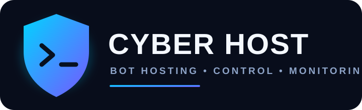

# CYBER HOST
### Telegram Bot Hosting & Management Platform

**Deploy • Manage • Monitor • Control**

*A modern, mobile-friendly dashboard to deploy and manage Telegram bot projects from one place.*

---

## 🎥 वीडियो ट्यूटोरियल — वेबसाइट कैसे इस्तेमाल करें (हिंदी में)

<!-- FILL: video record karke YouTube pe upload karo, phir neeche wala block uncomment karo aur VIDEO_ID badlo.

-->

### 📖 स्टेप-बाय-स्टेप गाइड

**1️⃣ अकाउंट बनाएं**
- नीचे दिए गए लिंक से वेबसाइट खोलें।
- **Get started** दबाकर **Register** करें और फिर **Sign in** करें।

**2️⃣ डैशबोर्ड समझें**
- **My Bots** — आपके सभी बॉट और उनका स्टेटस (Running / Stopped)।
- **Create Bot** — नया बॉट अपलोड करने के लिए।
- **Credit Store** — क्रेडिट प्लान खरीदने के लिए।
- **Payment History** — आपके पेमेंट रिक्वेस्ट देखने के लिए।
- **My Profile** — अकाउंट की जानकारी और Sign out।

**3️⃣ अपना पहला बॉट डालें**
- **Create Bot** खोलें।
- बॉट का नाम लिखें और `.py`, `.js` या `.zip` फाइल चुनें (या कोड सीधे पेस्ट करें)।
- अपने बॉट के Environment Variables भरें, जैसे `BOT_TOKEN`। टोकन किसी के साथ शेयर न करें।
- **Upload Project** दबाएं।
- आम यूज़र के बॉट को पहले एडमिन अप्रूव करता है। अप्रूव होने के बाद ही बॉट चलेगा।

**4️⃣ बॉट को कंट्रोल करें**
- **My Bots** में जाकर **Restart** से बॉट चालू करें, **Stop** से बंद करें।
- **Live Logs** में बॉट का आउटपुट और एरर दिखते हैं। बॉट न चले तो पहले लॉग देखें।
- **Terminal** से फाइल देखें और ज़रूरी पैकेज इंस्टॉल करें।
- सिंगल फाइल बॉट का कोड बदलना हो तो **Edit Code** दबाएं।

**5️⃣ क्रेडिट कैसे खरीदें**
- **Credit Store** खोलें और अपना प्लान चुनें।
- वेबसाइट पर दिए UPI ID या QR से पेमेंट करें।
- पेमेंट के बाद मिला **UTR / Reference नंबर** फॉर्म में डालें और **Submit Payment** दबाएं।
- एडमिन वेरिफाई करेगा, उसके बाद क्रेडिट आपके अकाउंट में जुड़ जाएंगे। स्टेटस **Payment History** में देखें।

**6️⃣ GitHub से बॉट डिप्लॉय करें**
- **GitHub** टैब खोलें और अपना अकाउंट कनेक्ट करें।
- रिपॉजिटरी चुनें, Environment Variables भरें और इम्पोर्ट करें।
- कोड अपडेट करने पर दोबारा इम्पोर्ट करना पड़ता है, यह अपने आप सिंक नहीं होता।

> ⏳ **ध्यान दें:** फ्री होस्टिंग पर वेबसाइट कुछ देर बाद सो जाती है, इसलिए पहली बार खुलने में 30–60 सेकंड लग सकते हैं। थोड़ा इंतज़ार करें।

### 🌐 वेबसाइट लिंक

## 👉 [https://hoster-1-1qzm.onrender.com/](https://hoster-1-1qzm.onrender.com/)

---

## ✨ Welcome to CYBER HOST

CYBER HOST is a web-based Telegram bot hosting and management platform. Users can create an account, upload or paste bot code, manage deployments, view logs and work with supported project files. Administrators can review submissions, manage users and credits, process payments, configure website settings and inspect bot storage.

The interface is designed to work comfortably on mobile browsers, including Android.

> **Project identity:** This README is the official usage guide for the CYBER HOST repository. The logo and check-style design elements are project branding; they do not represent third-party certification or GitHub account verification.

## 🚀 Supported Projects

| Type | Description |
|:--|:--|
| 🐍 **Python — .py** | Single-file Python Telegram bots |
| 🟨 **JavaScript — .js** | Node.js Telegram bots |
| 📦 **ZIP — .zip** | Multi-file bot projects and application folders |

## 📱 Getting Started

1. Open the CYBER HOST website.
2. Select **Register** and create your account.
3. Sign in using your account details.
4. Open the dashboard to access your bots, deployment tools and account features.

### Dashboard Overview

| Section | Purpose |
|:--|:--|
| 🤖 **My Bots** | View your deployed bots and their current statuses. |
| ➕ **Create Bot** | Deploy a bot by pasting code or uploading a project. |
| 💳 **Credit Store** | View available credit plans and payment details. |
| 🧾 **Payment History** | Track submitted payment requests. |
| 👤 **My Profile** | View account details and sign out. |

## ⚡ Deploy Your First Bot

### Method 1 — Paste Code

1. Open **Create Bot**.
2. Find **Deploy with pasted code**.
3. Enter a name for your bot.
4. Select **Python** or **JavaScript**.
5. Paste your source code.
6. Press **Deploy Code**.

### Method 2 — Upload a Project

1. Open **Create Bot**.
2. Enter a project name.
3. Select your supported .py, .js or .zip file.
4. Add the environment variables required by your project.
5. Press **Upload Project**.

### 🔐 Environment Variables

Environment variables keep configuration values outside your source code. Common examples include **BOT_TOKEN**, **API_ID**, **API_HASH** and database connection settings.

- Use the exact variable names expected by your bot.
- Add only values required by your project.
- Keep tokens, passwords and database credentials private.
- Never publish screenshots or source files containing live secrets.

### Approval Process

- Administrator-owned uploads are approved automatically.
- Normal user uploads are sent for administrator review.
- The administrator can approve or reject a pending deployment.
- Once approved, the bot can be started using its controls.

---

## 🎛️ Bot Management

Open **My Bots** to manage your deployments.

| Control | What it does |
|:--|:--|
| ▶️ **Start** | Starts an approved bot. |
| 🔄 **Restart** | Restarts the bot process. |
| ⏹️ **Stop** | Stops a running bot. |
| 🖥️ **Terminal** | Opens the browser-based project command interface. |
| 📜 **Live Logs** | Displays recent output and error messages. |
| ✏️ **Edit Code** | Edits supported single-file Python or JavaScript bots. |
| 🗑️ **Delete** | Removes the bot and its associated stored files. |

### Code Editor

For supported .py and .js bots, use **Edit Code** to update the source and bot name. Saving updates the stored source. If the bot was already approved, the website attempts to restart it using the updated code.

ZIP projects use their project files and terminal workflow; they are not edited through the single-file code editor.

## 📟 Terminal & Live Logs

### Browser Terminal
The terminal provides a mobile-friendly interface for selected project tasks, such as viewing files, checking runtime versions and installing supported dependencies.

It is a restricted project tool — not a complete Linux shell or unrestricted Termux replacement. Only commands supported by the website are available.

### Live Logs
Use logs to investigate issues such as:

- Missing environment variables.
- Invalid bot configuration.
- Dependency installation errors.
- Python or Node.js startup exceptions.
- Runtime errors printed by your bot.

Review the latest output, fix the reported issue and restart the bot.

---

## 💾 Automatic Bot Data & Persistent Storage

CYBER HOST creates a separate data location for each bot and can periodically back up supported runtime and data files through Supabase Storage.

### How the persistence feature works

1. A bot-specific data directory is created.
2. The bot receives directory paths through **BOT_DATA_DIR**, **DATA_DIR** and **PERSISTENT_DIR**.
3. The website periodically packages supported runtime files and bot data into a backup.
4. The backup is uploaded to the configured Supabase Storage bucket.
5. When the bot starts again, the website attempts to restore the latest available backup.

This can preserve supported files written to disk by the bot or its libraries. Data that exists only in RAM cannot be recovered by a file backup.

> **Important storage notes**
> - Supabase Storage must be configured correctly for remote backups.
> - Backups are periodic and best-effort, not real-time file synchronization.
> - A sudden crash may lose changes made after the last successful backup.
> - File-count and file-size limits apply.
> - Keep independent copies of important data and test restore behavior.
> - A bot must write its session or application data to disk (or an external database) for that data to persist.

## 💳 Credit Store & Payments

The Credit Store displays the plans enabled by the administrator.

### Submit a payment request

1. Open **Credit Store**.
2. Review the available plan and price.
3. Follow the payment instructions shown on the website.
4. Complete the payment in your payment application.
5. Enter the transaction UTR/reference in the payment form.
6. Submit the request.

Your request appears in **Payment History**. Credits are added after an administrator verifies and approves the payment. Submitting a reference does not mean the payment has already been approved.

---

## 🛡️ Admin Panel

Administrator-only pages provide management tools for the website.

| Admin Feature | Description |
|:--|:--|
| 🤖 **Bot Management** | View bots and owners, review pending submissions, approve or reject deployments. |
| 🗂️ **Bot File Manager** | Browse available runtime files and persistent-data files for individual bots. |
| 💰 **Payment Management** | Review payment references and approve or reject requests. |
| 👥 **User Management** | View registered accounts and manage user credits. |
| ⚙️ **Website Settings** | Configure site details, UPI information, payment QR and support text. |
| 🏷️ **Plans & Pricing** | Create plans, change prices and credits, and enable or disable plans. |
| 🔑 **API Access** | Create scoped API tokens, review permissions and revoke tokens. |

### 🗂️ Admin Bot File Manager

1. Open **Admin Panel → Bot Management**.
2. Select **Bot File Manager**.
3. Choose the bot you want to inspect.
4. Browse the files available for that bot.
5. Open a supported text file to preview or edit it.
6. Save changes when needed. Restart the bot if the changed file must be reloaded.

The file manager can show files available on the current instance and file entries indexed from the latest saved Supabase backup. Credential-like files — such as files associated with passwords, tokens, private keys or sessions — are protected from browser preview and editing.

The file manager is not a full remote desktop or unrestricted storage console. Its contents depend on files available to the application and the latest successful backup.

## 🔌 API Access

Administrators can create API tokens for approved integrations. Tokens can have selected permissions and an expiry period, and can be revoked from the Admin API page.

Permission groups include:

- **site:read** — read selected website settings.
- **users:read** — list registered users.
- **bots:read** — read bot details and statuses.
- **bots:control** — approve, reject, stop or restart bots.
- **bots:delete** — delete bots.
- **payments:read** — read payment requests.

API requests use a bearer token in the Authorization header. Keep tokens private and grant only the permissions an integration requires. The complete token is shown only when it is created.

## 🐙 GitHub Import

If GitHub integration is configured for the website, users can import a repository they are authorized to access.

1. Open **Create Bot** and choose **Connect GitHub**.
2. Authorize the GitHub connection.
3. Select a repository and branch.
4. Add the environment variables required by the project.
5. Start the import.

Imported projects follow the website's normal approval process. Importing copies the selected branch at that time; it does not automatically synchronize every later commit. Re-import to bring in newer code.

---

## 🔄 How CYBER HOST Works

**REGISTER** → **DEPLOY** → **ADMIN REVIEW** → **START BOT**  
↓  
**MONITOR LOGS** → **BACK UP DATA** → **MANAGE**

1. A user creates an account and submits a supported project.
2. The website stores the uploaded project and deployment details.
3. Normal user deployments wait for administrator approval.
4. After approval, the hosting service launches the bot process.
5. Users monitor bot status and output from the dashboard.
6. When configured, the persistence feature periodically backs up supported files to Supabase Storage.
7. Administrators manage deployments, users, payments, plans, website settings and API permissions.

## ⚠️ Important Hosting & Security Notes

- Runtime resources depend on the hosting provider and its plan.
- Free hosting services may sleep, restart or stop applications. Continuous 24/7 uptime is not guaranteed.
- Automatic backups depend on a working Supabase Storage configuration.
- Keep independent backups of important bot data.
- A bot must save its own data to disk or an external database; RAM-only data is temporary.
- Dependency installation can fail when a package is unavailable, incompatible or exceeds host resource limits.
- Uploaded bot code executes on the hosting server. Deploy only code you trust.
- Per-bot folders organize application data but do **not** provide hardened operating-system isolation between untrusted programs.
- Never share administrator credentials, API tokens, bot tokens or Supabase service credentials.

---

### CYBER HOST
**One dashboard. Your bots. Easier control.**

🌐 **Website:** https://hoster-1-1qzm.onrender.com/

**Owner — Anand Singh**

Official project documentation • CYBER HOST

